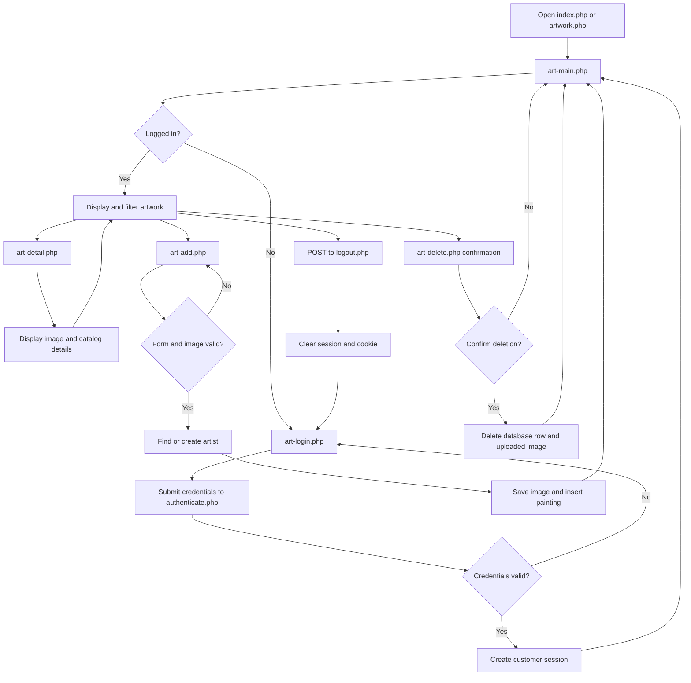

# Art Gallery

A PHP and MySQL website for browsing and managing paintings, artists, galleries, eras, genres and subjects. Users sign in to view details, filter artwork, upload paintings and manage related records. The application uses HTML/CSS and the Lab 14 `art` database.

## Pages

- `galleries.php`: list galleries and their painting counts.
- `gallery-detail.php`: view a gallery's details and linked paintings.
- `gallery-add.php`: add a gallery.
- `gallery-delete.php`: confirm deletion and block it while paintings reference the gallery.
- `genres.php`, `genre-add.php`, `genre-delete.php`: genre catalog with names, descriptions, painting counts, add and protected delete pages.
- `eras.php`: view and search eras by name or year range, with links to details, update and delete.
- `era-detail.php`: view one era's complete name and year information.
- `era-add.php`: add an era after validating its name and years and checking for a duplicate name.
- `era-update.php`: update an era's years while keeping its identifying name unchanged.
- `era-delete.php`: confirm and delete an era.
- `painting-genres.php`: view paintings with their assigned genres, followed by genre descriptions, painting counts and management links. Genre names open `genre-detail.php`, which returns to Painting genres.
- `painting-genre-add.php`: add a genre with a unique name and optional description.
- `painting-genre-delete.php`: confirm deletion; blocks deletion while any existing painting is linked through `PaintingGenres`, including on direct POST requests. Unused stale associations are removed with the genre.
- `subjects.php`, `subject-detail.php`, `subject-add.php`, `subject-delete.php`: browse subjects and painting counts, view linked paintings, add a named subject, and confirm deletion of an unused subject.
- `painting-subjects.php`: show each linked painting once with its image, title and all assigned subjects. Each subject has its own delete link; new links can be added. Subject names and painting counts are listed separately on `subjects.php`.
- `painting-subject-add.php`: link a painting to a subject after validating both IDs and checking for a duplicate link.
- `painting-subject-delete.php`: confirm and remove only the selected painting-subject link.
- `artists.php`: view artists and their painting counts, with links to add and delete artists.
- `artist-add.php`: add an artist with a required last name and optional first name, nationality and birth/death years.
- `artist-delete.php`: confirm deletion; artists with paintings cannot be deleted. The check also runs on submission.
- `art-login.php`: User ID/password form.
- `authenticate.php`: checks Lab14 `Customers` and `CustomerLogon`, then opens `art-main.php`.
- `art-main.php`: basic painting table, artist selection, ADD link and Delete links.
- `art-detail.php`: detailed artwork image, artist, year, medium, dimensions, genre and description.
- `art-add.php`: title, typed artist name, optional year and an uploaded image.
- `art-delete.php`: confirmation followed by deletion of the selected PaintingID.
- `logout.php`: Sign out. `index.php` and `artwork.php` open the gallery.

All gallery operations require login. The four accounts are `user1/pass1` through `user4/pass4`; their names are `first1 last1` through `first4 last4`. Password hashes, prepared statements and existing form tokens are retained.

The original `Subjects` table has names but no IDs. The one-time setup below gives it stable `SubjectID` values matching the original 21 seed entries, including both Abstract entries (IDs 5 and 21). Existing painting-subject links remain unchanged. The original table is retained as `Subjects_without_ids_backup`. The painting-subject pages automatically use the new real IDs.

### Subjects setup (once per database)

Start MySQL, then run from this project folder:

```sh
/Applications/XAMPP/xamppfiles/bin/php scripts/setup-subjects.php
```

The setup only converts the original seed data; it stops if names have changed rather than guessing the ID mapping. Running it again after setup makes no changes. Run this command again after a fresh import of `art-small.sql`; keep or rename any existing backup/staging table before attempting another conversion. Then open `http://localhost:8000/subjects.php` after signing in. Creating or deleting subjects changes the subject catalog; assigning them to paintings remains on Painting subjects. A subject with any painting-subject links cannot be deleted. New names must be nonempty, at most 255 characters, and must not already exist. The original duplicate Abstract rows are retained.


## Application flow

1. **Open the application.** Visiting `index.php` or `artwork.php` loads `art-main.php`. If there is no authenticated customer in the PHP session, `art_require_login()` redirects the browser to `art-login.php`.
2. **Sign in.** `art-login.php` displays the customer login form. The form sends the user ID, password and CSRF token to `authenticate.php` with `POST`. The authentication code looks up an enabled account in `CustomerLogon`, joins it to `Customers`, and verifies the stored password hash. A successful login regenerates the session ID, stores the customer and a CSRF token in the session, and redirects to `art-main.php`. An unsuccessful login redisplays the form with an error.
3. **View and filter artwork.** `art-main.php` reads paintings and artists from MySQL and displays the collection. The Artist, Title and Year filters are submitted with `GET`; the page validates them and uses a prepared query to return matching paintings. Clearing the filters reloads the complete collection. Selecting a painting image or title opens `art-detail.php`, which displays its complete image and available catalog information.
4. **Add artwork.** The **ADD artwork** link opens `art-add.php`. On submission, the page checks the CSRF token, validates the title, artist, optional year and image, and accepts JPEG, PNG, GIF or WebP files up to 5 MB. It reuses a matching artist or creates a new artist, saves the image, inserts the painting inside a database transaction, and redirects back to the gallery with a success message. If saving fails, the transaction is rolled back and any partly saved uploaded image is removed.
5. **Delete artwork.** A row's **Delete** button opens `art-delete.php?id=...`, which first shows a confirmation page. Confirming sends a `POST` request with the CSRF token. The painting is locked and deleted inside a transaction. Images uploaded through this application are also removed, while the original Lab 14 image files are preserved. The browser then returns to the gallery with a status message.
6. **Sign out.** The **Sign out** form sends a CSRF-protected `POST` request to `logout.php`. It clears the session, expires the session cookie and redirects to `art-login.php`.

Shared code in `includes/app.php` provides the database connection, session and login checks, CSRF validation, safe HTML output, image lookup, page layout and error handling. `includes/auth.php` contains credential verification and sign-in functions. Every gallery page that reads or changes collection data calls `art_require_login()` first.



## Setup

This folder is self-contained. Copy `artwork/` into `htdocs` and open `/artwork/art-login.php` after importing its SQL files.

For another XAMPP server:

1. Copy `artwork/` into `htdocs`.
2. Use PHP 8.1+ with mysqli and mbstring. Import the original Lab 14 database from `sql/art-small.sql`, then import `sql/users.sql` to add the four sample accounts.
3. Edit `config.php` for the server. Standard XAMPP usually uses port 3306. Enable the included Apache `.htaccess` restrictions.
4. Give PHP write access to `images/art/works/square-medium/`.
5. Open `/artwork/art-login.php` and sign in.

## Run this project from Terminal (macOS)

Install XAMPP first. For everyday use, run:

```sh
cd "/Users/tongvinhthai/Desktop/Fall 2026/CS 4485/Task4C/artwork"
sh start-local.sh
```

Enter your Mac login password if prompted; Terminal does not show characters while you type it. Keep Terminal open, then visit:

**http://localhost:8000/art-login.php**

Sign in with `user1/pass1`, or `user2/pass2` through `user4/pass4`.

The script starts XAMPP MySQL, checks access to the configured database and login table, and serves this exact project folder using XAMPP PHP. It creates a private session folder in your Mac account's temporary directory and explicitly tells PHP to use it on every launch. This avoids the “form has expired” error caused by the default XAMPP session folder being unwritable when PHP runs under your Mac account. Apache is not needed for this local development command.

Press **Control + C** to stop the website. Run the same command next time. MySQL stays running; to stop it when finished:

```sh
sudo /Applications/XAMPP/xamppfiles/xampp stopmysql
```

### First-time database setup

Only if the database has not been installed, start MySQL and import the SQL files in order from this project folder:

```sh
sudo /Applications/XAMPP/xamppfiles/xampp startmysql
/Applications/XAMPP/xamppfiles/bin/mysql --socket=/Applications/XAMPP/xamppfiles/var/mysql/mysql.sock -u root < sql/art-small.sql
/Applications/XAMPP/xamppfiles/bin/mysql --socket=/Applications/XAMPP/xamppfiles/var/mysql/mysql.sock -u root < sql/users.sql
```

Do not repeat these imports on everyday startup: they can reset existing data. The defaults in `config.php` use database `art`, host `127.0.0.1`, port `3306`, and user `root` with an empty password. Update that file if your MySQL settings differ.

### Troubleshooting

- **“Address already in use”:** another server is using port 8000. Stop the earlier server with Control + C in its Terminal, then run `sh start-local.sh` again.
- **“Database check failed”:** ensure MySQL started, check `config.php`, and complete the first-time imports if needed.
- **“The form has expired”:** open a fresh `http://localhost:8000/art-login.php` page and submit again. Forms opened before a session was cleared or replaced have an old token. Use the same hostname throughout the session.
- **After restarting your Mac:** run `sh start-local.sh` again. The script recreates the temporary session folder if macOS removed it.

This command handles the session-folder setup each time, but startup still depends on XAMPP being installed, MySQL being available, the database being installed, and port 8000 being free. The PHP development server is used for local development.

The supplied collection contains 319 paintings and 319 images.

Choose **No / Never** when asked to save passwords, and Sign out before changing users. The website uses HTML/CSS, PHP and MySQL.

## Genres module reference

### Features

The Genres module lists genres and painting counts, displays genre details, adds genres, and confirms deletion of unused genres.

### Modules and user interface

| File | Responsibility |
| --- | --- |
| genres.php | Alphabetical table of names, descriptions and painting counts; add/delete links |
| genre-detail.php | ID, name, description, safe reference link and linked painting titles |
| genre-add.php | Required name, optional description and reference URL; validation errors preserve input |
| genre-delete.php | Confirmation form; blocks deletion when existing paintings use the genre |
| includes/app.php | Existing login, database, layout, escaping and CSRF helpers; adds Genres navigation |

The Painting genres page now displays paintings with their assigned genres and links genre names to genre-detail.php. The detail page returns to Painting genres. Both sets of add/delete pages operate on Genres; they do not create or remove PaintingGenres relationships.

### Data dictionary

Source: sql/art-small.sql, Genres table. No schema migration is required.

| Column | Database definition | Application behavior |
| --- | --- | --- |
| GenreID | INTEGER, auto increment, primary key | Database assigns ID; users cannot edit it |
| GenreName | VARCHAR(50), required, unique | Trimmed, 1–50 characters; duplicates rejected |
| Description | LONGTEXT, nullable | Optional; form limits input to 10,000 characters |
| Link | VARCHAR(255), nullable | Optional HTTP/HTTPS URL, maximum 255 characters |

PaintingGenres associates GenreID with PaintingID. List/detail queries join Paintings so counts and links only include existing paintings. Deletion checks these associations again inside a transaction, locks records, and refuses to delete a genre used by a painting. It removes stale associations before deleting an unused genre. Adding a genre does not accept foreign keys.

### Use cases

All actions require an authenticated customer. Unauthenticated requests redirect to sign in.

1. View: select Genres in navigation. The server queries Genres and painting counts, then renders the list, including an empty-state message when appropriate.
2. Details: open Painting genres and select a genre name. The server validates the ID, fetches the genre and linked paintings, and renders details. Invalid IDs return 400; missing records return 404.
3. Add: select ADD genre, enter fields, and submit. The server checks the CSRF token and validates fields, then inserts with a prepared statement. Success redirects to the list with a message. Invalid fields or a duplicate name return 422 with errors. Cancel returns without writing.
4. Delete: select Delete. GET shows a confirmation without deleting. If paintings use the genre, the page explains why deletion is unavailable. A confirmed POST checks CSRF and repeats the association check in a transaction. Successful deletion redirects to the list. A direct POST for a used genre returns 409. Keep genre returns without writing.
