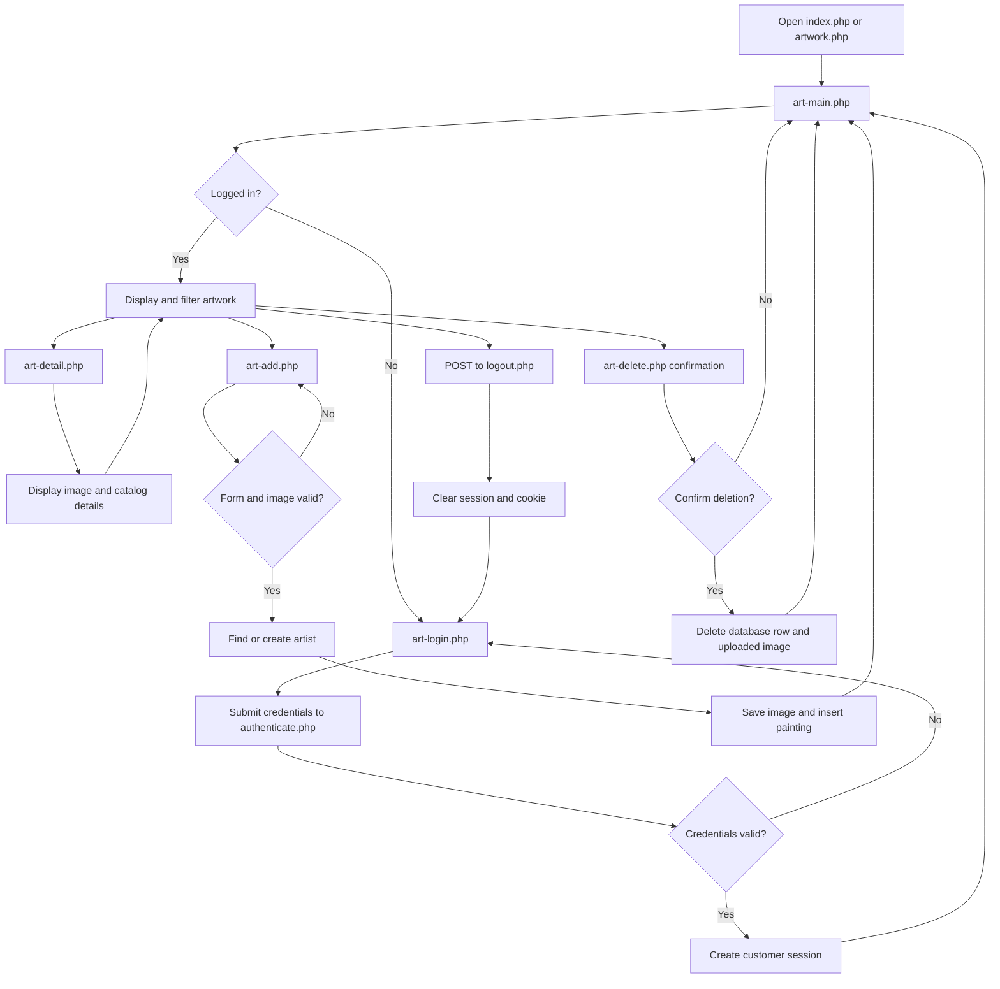

# Art Gallery — Parts 3, Bonus and 4

Thai Tong · vxt220041 · Team 42

**Part(3) Bonus completed:** ADD stores a painting in the original Lab14 `art.Paintings` table. View, delete and customer login are also completed.

## Pages

- `galleries.php`: list galleries and their painting counts.
- `gallery-detail.php`: view a gallery's details and linked paintings.
- `gallery-add.php`: add a gallery.
- `gallery-delete.php`: confirm deletion and block it while paintings reference the gallery.
- `genres.php`, `genre-detail.php`, `genre-add.php`, `genre-delete.php`: dedicated Genres list, details, add and protected delete pages. See `GENRES.md` for module documentation and manual test cases.
- `eras.php`: view and search eras by name or year range, with links to details, update and delete.
- `era-detail.php`: view one era's complete name and year information.
- `era-add.php`: add an era after validating its name and years and checking for a duplicate name.
- `era-update.php`: update an era's years while keeping its identifying name unchanged.
- `era-delete.php`: confirm and delete an era.
- `painting-genres.php`: view painting genres, descriptions and painting counts.
- `painting-genre-add.php`: add a genre with a unique name and optional description.
- `painting-genre-delete.php`: confirm deletion; blocks deletion while any existing painting is linked through `PaintingGenres`, including on direct POST requests. Unused stale associations are removed with the genre.
- `painting-subjects.php`: view each subject's painting count and the individual painting-subject links.
- `painting-subject-add.php`: link a painting to a subject after validating both IDs and checking for a duplicate link.
- `painting-subject-delete.php`: confirm and remove only the selected painting-subject link.
- `artists.php`: view artists and their painting counts, with links to add and delete artists.
- `artist-add.php`: add an artist with a required last name and optional first name, nationality and birth/death years.
- `artist-delete.php`: confirm deletion; artists with paintings cannot be deleted. The check also runs on submission.
- `art-login.php`: User ID/password form.
- `authenticate.php`: checks Lab14 `Customers` and `CustomerLogon`, then opens `art-main.php`.
- `art-main.php`: basic painting table, artist selection, ADD link and Delete links.
- `art-detail.php`: detailed artwork image, artist, year, medium, dimensions, genre and description.
- `art-add.php`: title, typed artist name, optional year and an uploaded image.
- `art-delete.php`: confirmation followed by deletion of the selected PaintingID.
- `logout.php`: Sign out. `index.php` and `artwork.php` open the gallery.

All gallery operations require login. The four accounts are `user1/pass1` through `user4/pass4`; their names are `first1 last1` through `first4 last4`. Password hashes, prepared statements and existing form tokens are retained.

The supplied `Subjects` table has names but no `SubjectID` column, while `PaintingSubjects` stores numeric subject IDs. The painting subject pages use the original `art-small.sql` seed order to label IDs when the database still contains those 21 names; otherwise they show subject numbers. If the Subjects module later adds a `SubjectID` column, these pages use it directly. Until then, subject IDs are validated against the count of rows in `Subjects`; the database itself cannot enforce that relationship.

## Application flow

1. **Open the application.** Visiting `index.php` or `artwork.php` loads `art-main.php`. If there is no authenticated customer in the PHP session, `art_require_login()` redirects the browser to `art-login.php`.
2. **Sign in.** `art-login.php` displays the customer login form. The form sends the user ID, password and CSRF token to `authenticate.php` with `POST`. The authentication code looks up an enabled account in `CustomerLogon`, joins it to `Customers`, and verifies the stored password hash. A successful login regenerates the session ID, stores the customer and a CSRF token in the session, and redirects to `art-main.php`. An unsuccessful login redisplays the form with an error.
3. **View and filter artwork.** `art-main.php` reads paintings and artists from MySQL and displays the collection. The Artist, Title and Year filters are submitted with `GET`; the page validates them and uses a prepared query to return matching paintings. Clearing the filters reloads the complete collection. Selecting a painting image or title opens `art-detail.php`, which displays its complete image and available catalog information.
4. **Add artwork.** The **ADD artwork** link opens `art-add.php`. On submission, the page checks the CSRF token, validates the title, artist, optional year and image, and accepts JPEG, PNG, GIF or WebP files up to 5 MB. It reuses a matching artist or creates a new artist, saves the image, inserts the painting inside a database transaction, and redirects back to the gallery with a success message. If saving fails, the transaction is rolled back and any partly saved uploaded image is removed.
5. **Delete artwork.** A row's **Delete** button opens `art-delete.php?id=...`, which first shows a confirmation page. Confirming sends a `POST` request with the CSRF token. The painting is locked and deleted inside a transaction. Images uploaded through this application are also removed, while the original Lab 14 image files are preserved. The browser then returns to the gallery with a status message.
6. **Sign out.** The **Sign out** form sends a CSRF-protected `POST` request to `logout.php`. It clears the session, expires the session cookie and redirects to `art-login.php`.

Shared code in `includes/app.php` provides the database connection, session and login checks, CSRF validation, safe HTML output, image lookup, page layout and error handling. `includes/auth.php` contains credential verification and sign-in functions. Every gallery page that reads or changes collection data calls `art_require_login()` first.



## Setup

This folder is self-contained. Copy `artwork/` into `htdocs` and open `/artwork/art-login.php` after importing its SQL files.

For another XAMPP server:

1. Copy `artwork/` into `htdocs`.
2. Use PHP 8.1+ with mysqli and mbstring. Import the original Lab 14 database from `sql/art-small.sql`, then import `sql/users.sql` to add the four assignment accounts.
3. Edit `config.php` for the server. Standard XAMPP usually uses port 3306. Enable the included Apache `.htaccess` restrictions.
4. Give PHP write access to `images/art/works/square-medium/`.
5. Open `/artwork/art-login.php` and sign in.

## Run XAMPP from Terminal (macOS)

Open Terminal and start Apache and MySQL together:

```sh
sudo /Applications/XAMPP/xamppfiles/xampp start
```

Enter your Mac login password when `sudo` asks for it. Terminal does not display characters while the password is being typed.

To start the two services separately instead:

```sh
sudo /Applications/XAMPP/xamppfiles/xampp startapache
sudo /Applications/XAMPP/xamppfiles/xampp startmysql
```

If the `art` database has not been installed, run these commands from the `artwork` folder. Import the files in this order:

```sh
cd /Applications/XAMPP/xamppfiles/htdocs/artwork
/Applications/XAMPP/xamppfiles/bin/mysql --socket=/Applications/XAMPP/xamppfiles/var/mysql/mysql.sock -u root < sql/art-small.sql
/Applications/XAMPP/xamppfiles/bin/mysql --socket=/Applications/XAMPP/xamppfiles/var/mysql/mysql.sock -u root < sql/users.sql
```

Then open the login page from Terminal:

```sh
open http://localhost/artwork/art-login.php
```

Sign in with `user1/pass1`, or use `user2/pass2` through `user4/pass4`.

When finished, stop XAMPP:

```sh
sudo /Applications/XAMPP/xamppfiles/xampp stop
```

If Apache is configured for port 8080, use `http://localhost:8080/artwork/art-login.php` instead.

The source contains 319 paintings and 319 images. Sorting, pagination, branding and JavaScript previews are omitted to keep the assignment simple.

Choose **No / Never** when asked to save passwords, and Sign out before changing users. The website uses HTML/CSS, PHP and MySQL.
